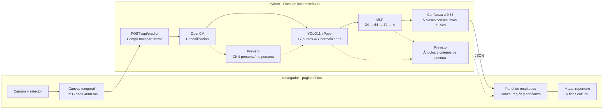
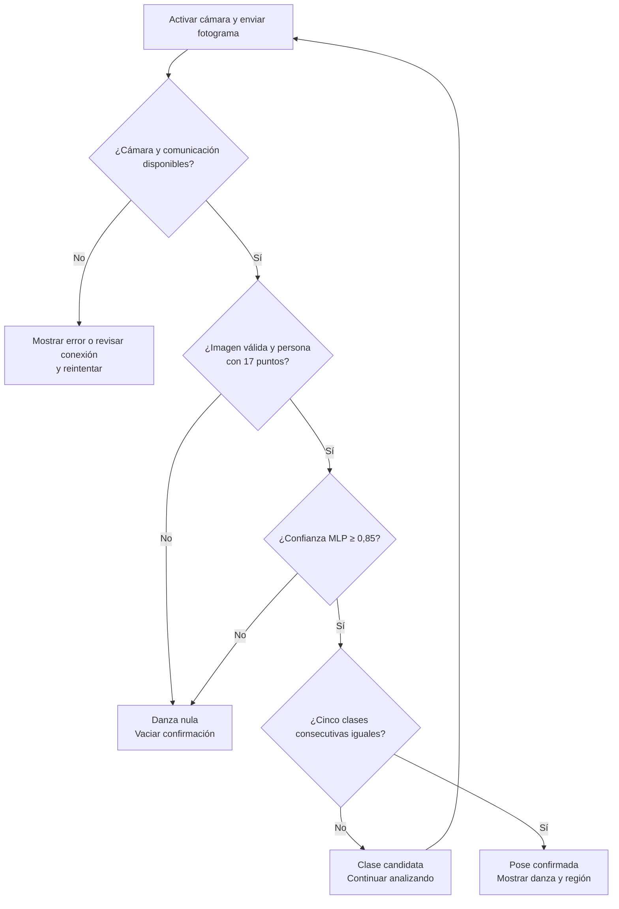
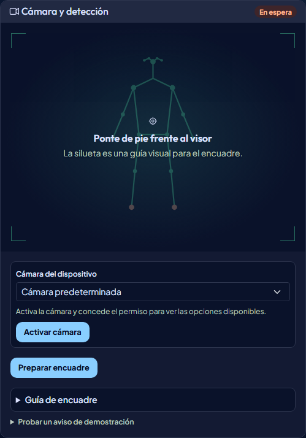

# Colombia en Movimiento

**Una experiencia cultural interactiva que conecta las danzas colombianas con el reconocimiento de posturas mediante visión computacional.**

El visitante explora un mapa cultural, elige una danza o se coloca frente a la cámara para ensayar una pose. La aplicación integra una interfaz multimedia y un servicio Python local que combina YOLO11 Pose con un clasificador de cuatro posturas. El resultado se asocia con una danza y su región dentro de la misma página.


[Repositorio](https://github.com/SantiagoMejia064/SistemaVisionComputacional) · [Datos y modelos](https://drive.google.com/drive/folders/1OiU35X_bGq5RkKuuXAHBH0aeCmfa8w46?usp=sharing) · [Prototipo en Figma](https://www.figma.com/design/E15852kz3GEqF0mtmDZLiC/Untitled?node-id=0-1) · [Ejecución local](#ejecucion-local) · [API](#api)


*Captura del frontend del workspace a 1280 px. Cámara apagada y resultado pendiente. Esta imagen documenta la interfaz, no una inferencia.*

<a id="contenido"></a>
## Contenido

- [Descripción y propuesta de valor](#propuesta)
- [Objetivos](#objetivos)
- [Funcionalidades y estado de integración](#funcionalidades)
- [Arquitectura técnica](#arquitectura)
- [Metodología](#metodologia)
- [Tecnologías](#tecnologias)
- [Estructura del repositorio](#estructura)
- [Datos y modelos](#datos-modelos)
- [Instalación y ejecución local](#ejecucion-local)
- [Guía de uso](#uso)
- [API local](#api)
- [Interfaz y evidencias](#interfaz)
- [Pruebas y evaluación](#pruebas)
- [Resultados y discusión](#resultados)
- [Conclusiones](#conclusiones)
- [Equipo y créditos](#equipo)
- [Referencias y atribuciones](#referencias)

<a id="propuesta"></a>
## Descripción y propuesta de valor

### Problema y contexto

El patrimonio cultural se transmite a través de prácticas, músicas, relatos y movimientos que pueden resultar difíciles de explorar mediante una presentación exclusivamente textual. Una instalación interactiva ofrece un punto de entrada para relacionar una expresión cultural con su territorio, observarla y participar corporalmente.

Colombia en Movimiento propone ese encuentro para visitantes de espacios museográficos, estudiantes y personas interesadas en las danzas colombianas. La cámara sirve como medio de interacción con un catálogo cultural y como entrada al procesamiento digital de imágenes.

### Solución

La experiencia concentra el mapa, las cuatro danzas, el visor, la ficha cultural y los resultados en una sola página. El visitante puede explorar el repertorio de forma directa o activar la cámara para iniciar el análisis automático de su postura.

El reconocimiento utiliza puntos corporales normalizados, una clasificación de poses y una confirmación temporal. La interpretación cultural se presenta mediante fichas de región, historia, música y vestuario. Las áreas de fotografía y video están preparadas para incorporar recursos definitivos.

La propuesta combina una interacción corporal sencilla, contenido cultural accesible desde la interfaz y ejecución local. Los controles de teclado, las etiquetas del formulario, las guías de encuadre y la composición responsive facilitan su uso. La accesibilidad completa queda sujeta a una evaluación específica.

El nombre utilizado en el código y la interfaz es **Colombia en Movimiento**. *Territorio en Movimiento* corresponde a una denominación inicial del proyecto.

<a id="objetivos"></a>
## Objetivos

### Objetivo general

Desarrollar una experiencia multimedia local que facilite la exploración de cuatro danzas tradicionales colombianas mediante una interfaz cultural y el reconocimiento de poses corporales con visión computacional.

### Objetivos específicos

- Asociar Cumbia, Currulao, Bambuco y Joropo con sus regiones y contenidos culturales.
- Ofrecer una página interactiva con mapa SVG, repertorio, visor y resultados contextuales.
- Capturar fotogramas de la cámara y comunicarlos a un servicio Python local.
- Extraer 17 puntos corporales mediante YOLO Pose y clasificar las poses con un MLP.
- Aplicar criterios de confianza y consistencia temporal antes de confirmar una danza.
- Incorporar progresivamente el filtro CNN de presencia, la evaluación geométrica y los recursos audiovisuales.
- Validar el reconocimiento y la interacción mediante escenarios reproducibles y métricas de clasificación y respuesta.

<a id="funcionalidades"></a>
## Funcionalidades y estado de integración

### Repertorio cultural

| Danza | Región | Pose de interacción mostrada |
| --- | --- | --- |
| Cumbia | Caribe | Brazos arriba |
| Currulao | Pacífica | Brazos al lado |
| Bambuco | Andina | Pierna arriba |
| Joropo | Orinoquía | Mano diagonal |

Estas etiquetas identifican las poses de interacción del repertorio. Representan consignas para utilizar la aplicación, no una descripción exhaustiva de los movimientos tradicionales de cada danza. El orden de las clases del MLP se lee desde el checkpoint del modelo.

### Estado del código inspeccionado

| Componente | Estado actual |
| --- | --- |
| Página única y exploración | Implementadas. Las tarjetas actualizan la ficha cultural sin recargar la página. |
| Mapa cultural SVG | Implementado. Cuatro regiones con resaltado CSS al pasar el cursor o enfocar. El clic no selecciona una danza. |
| Cámara | Acceso mediante `getUserMedia()`, selector de dispositivo, apagado y gestión de errores implementados en `main.js`. |
| Captura y comunicación | `deteccion.js` genera JPEG y los envía al backend cada 4000 ms, mientras no haya otra solicitud en curso. |
| YOLO11 Pose + MLP | Implementados en Python. Su ejecución completa requiere colocar el checkpoint del clasificador. |
| Confirmación temporal | La API confirma cinco clases consecutivas iguales aceptadas por el clasificador. |
| Resultado visible | El frontend actualiza danza, región y confianza cuando recibe una confirmación. |
| CNN binaria de presencia | Planificada. `backend/cnn/` contiene únicamente `.gitkeep`. |
| Cálculo y evaluación de ángulos | Planificados. `backend/angulos/` contiene únicamente `.gitkeep`. |
| Esqueleto y telemetría web | Contenedores preparados. La API actual no devuelve keypoints ni ángulos. |
| Fotografía, video y audio | Espacios pendientes de recursos. No hay reproducción audiovisual de las danzas implementada. |
| Recuperación | Hay errores reales de acceso a cámara, mensaje de backend no disponible y cuatro avisos seleccionables de demostración. |

**Alcance de la verificación.** La revisión del 18 de noviembre de 2026 incluye lectura del código, consulta del directorio de Drive y comprobación de la interfaz en Edge. El archivo `models/yolo/pose_classifier.pth` falta en este workspace y el intérprete Python accesible no pudo ejecutarse. El reconocimiento con modelos reales y las métricas de desempeño permanecen pendientes de validación.

<a id="arquitectura"></a>
## Arquitectura técnica

### Cliente y servidor en localhost

El navegador sirve la experiencia cultural y captura video. Flask recibe fotogramas por HTTP en `127.0.0.1:5000`, OpenCV los decodifica, YOLO estima la postura y PyTorch clasifica las características. La respuesta vuelve al panel de resultados de la misma página.

La aplicación trabaja con imágenes temporales en memoria. El código de inferencia no guarda capturas, videos ni resultados de visitantes en archivos o bases de datos. La API mantiene una cola temporal de cinco clases para confirmar predicciones. Esa cola es global al proceso y se comparte entre clientes, por lo que la implementación actual está orientada a un visitante activo por instancia local.

Los pesos de los modelos sí se conservan como archivos locales. Los enlaces de Drive sirven para distribuir recursos de desarrollo. La inferencia está diseñada para ejecutarse en el equipo local.

### Arquitectura actual y extensiones previstas

Las líneas discontinuas indican módulos previstos.



En el flujo actual OpenCV entrega la imagen directamente a YOLO. La CNN binaria será un filtro previo de presencia. El módulo geométrico podrá utilizar los puntos de YOLO y la clase reconocida para comparar ángulos con referencias por definir.

### Pipeline implementado

1. El usuario activa la cámara y concede permiso. La transmisión se muestra sin audio.
2. `encenderCamara()` limpia los resultados e invoca `iniciarDeteccion()`.
3. El frontend solicita `POST /api/reset` y programa un intento de captura cada cuatro segundos.
4. Un canvas toma el fotograma con las dimensiones del video. `toBlob()` lo codifica como JPEG con calidad `0.8`.
5. El navegador envía la imagen en `FormData`, campo `frame`, a `POST /api/predict`.
6. OpenCV decodifica la imagen en BGR. YOLO11n Pose se ejecuta con `conf=0.25`.
7. El clasificador toma la primera persona de `keypoints.xyn[0]`. Comprueba que existan 17 puntos y aplana sus coordenadas X/Y normalizadas en 34 características.
8. El MLP aplica capas lineales `34→64→32→4`, ReLU entre capas y Dropout `0.20` durante entrenamiento. Se utiliza `eval()`, `no_grad()` y softmax en inferencia.
9. Si la máxima probabilidad es inferior a `0.85`, el clasificador devuelve una clase nula. La API borra la cola temporal.
10. Cinco clases aceptadas, consecutivas e iguales producen `confirmada: true`. El navegador muestra danza, región y confianza, detiene el intervalo y libera las pistas de cámara.

La confianza devuelta corresponde al fotograma que completa la confirmación. No es un promedio temporal ni una métrica de accuracy. El intervalo de cuatro segundos es una configuración de muestreo, no una medición de latencia. La confirmación exige varios fotogramas y su tiempo real depende de la captura, las solicitudes y la inferencia.

### Decisiones y salidas



La API actual agrupa imagen inválida, ausencia de persona, cantidad de puntos incorrecta y confianza insuficiente bajo la misma salida de clase nula. El frontend muestra «Analizando postura» ante cualquier respuesta no confirmada. Los avisos detallados de datos inválidos, predicción incierta y cero hallazgos son demostraciones de interfaz, no diagnósticos diferenciados del backend.

El flujo objetivo añade la CNN binaria antes de YOLO, una validación más completa del fotograma y la evaluación geométrica. La captura manual también forma parte del alcance previsto. Actualmente el envío es periódico y no existe un botón de captura manual conectado a la API.


<a id="metodologia"></a>
## Metodología de desarrollo

El trabajo se organiza en cuatro momentos iterativos. Cada momento vincula las decisiones de producto con sus implicaciones de arquitectura, interacción y validación.

| Momento | Propósito | Actividades y decisiones | Entregable |
| --- | --- | --- | --- |
| 1. Usuario y escenario | Definir la experiencia cultural y su utilidad | Delimitar usuario, entorno museográfico, necesidad de exploración y relación entre pose, danza y región | Escenario de uso, requisitos y repertorio de cuatro danzas |
| 2. Arquitectura y pipeline | Distribuir responsabilidades y definir entradas y salidas | Separar navegador y Python, evaluar modelos, definir fotogramas, keypoints, clasificación y confirmación | Pipeline local y contratos HTTP |
| 3. Prototipado de la GUI | Dar continuidad visual a la interacción | Prototipos en Figma, mapa, cámara, catálogo, ficha cultural, resultados y retroalimentación | GUI en HTML, CSS y JavaScript |
| 4. Desarrollo, integración y validación | Conectar componentes y contrastar su comportamiento | Implementar cámara, captura, Flask, YOLO y MLP, probar integración y preparar evaluación por escenario | Código integrado y evidencias, con validación cuantitativa pendiente |

La interfaz evolucionó desde seis pantallas de referencia hacia una sola experiencia donde cambian los paneles. La composición retoma `iDEA 2` y la identidad cromática de `IDEA 1`, con fondos azul oscuro y acentos celestes, verdes y naranjas. El reconocimiento avanzó hacia una solución YOLO11 Pose + MLP. La CNN prevista se define ahora como un filtro binario de presencia.

Los nombres históricos «CNN» de algunos campos del frontend y «YOLOv8» de ciertos avisos reflejan etapas anteriores. La arquitectura documentada se basa en los imports, pesos y operaciones actuales. La validación completa de modelos y usuarios pertenece al cuarto momento y aún requiere evidencias. [Prototipo de referencia](https://www.figma.com/design/E15852kz3GEqF0mtmDZLiC/Untitled?node-id=0-1).

<a id="tecnologias"></a>
## Tecnologías utilizadas

| Tecnología | Función | Ubicación o estado |
| --- | --- | --- |
| HTML5 y CSS3 | Estructura semántica, paneles, responsive y paleta | `frontend/index.html`, `frontend/css/styles.css` |
| Bootstrap 5.3.8 | Distribución y componentes visuales | CSS local en `frontend/css/` |
| JavaScript vanilla | Selección cultural, estados, cámara y comunicación | `frontend/js/main.js`, `frontend/js/deteccion.js` |
| SVG | Mapa cultural, pines, iconos y silueta de referencia | `frontend/assets/maps/`, `frontend/assets/icons/` |
| MediaDevices y getUserMedia | Permisos, video y selección de cámaras | `main.js` |
| Canvas, Blob, FormData y Fetch | Captura JPEG y envío HTTP | `deteccion.js` |
| Python, Flask y Flask-CORS | Servicio HTTP local y acceso entre puertos | `backend/yolo/api.py` |
| OpenCV y NumPy | Decodificación de imagen y datos numéricos | `clasificador.py`, `test_camara.py` |
| Ultralytics YOLO11 Pose | Estimación de 17 puntos corporales | Peso `yolo11n-pose.pt` |
| PyTorch | Clasificador MLP y carga de checkpoint | `clasificador.py` |
| Figma | Prototipado de la experiencia | Referencia externa de diseño |
| CNN binaria y geometría de ángulos | Presencia y evaluación de postura | Módulos planificados |

El repositorio no contiene un manifiesto de dependencias Python ni versiones fijadas. La instalación siguiente deriva de los imports actuales y requiere validar las versiones resueltas con el checkpoint de entrenamiento.

<a id="estructura"></a>
## Estructura del repositorio

El árbol resume los archivos reales inspeccionados. Las carpetas de reserva contienen `.gitkeep`. Bootstrap y los archivos de fuentes se distribuyen localmente con la interfaz.

```text
SistemaVisionComputacional/
├── frontend/
│   ├── index.html
│   ├── css/
│   │   ├── styles.css
│   │   ├── bootstrap.min.css
│   │   └── bootstrap-LICENSE.txt
│   ├── js/
│   │   ├── main.js
│   │   └── deteccion.js
│   └── assets/
│       ├── fonts/                  # Outfit, Jakarta y licencias OFL
│       ├── icons/                  # interfaz.svg y postura.svg
│       └── maps/colombia.svg
├── backend/
│   ├── cnn/                        # Reserva
│   ├── angulos/                    # Reserva
│   └── yolo/
│       ├── api.py                  # Endpoints Flask
│       ├── clasificador.py         # YOLO y MLP
│       └── test_camara.py          # Herramienta manual con OpenCV
├── notebooks/
│   ├── cnn/                        # Reserva
│   ├── yolo/                       # Reserva
│   └── angulos/                    # Reserva
├── models/
│   ├── cnn/                        # Reserva
│   └── yolo/                       # Destino del checkpoint MLP
├── data/
│   ├── imagenes/                   # Reserva
│   ├── anotaciones/                # Reserva
│   └── referencias/                # Reserva
├── docs/images/                    # Evidencias del README
├── yolo11n-pose.pt                 # Peso YOLO local
├── .gitattributes
├── .gitignore
└── README.md
```

El checkpoint `pose_classifier.pth` es un recurso externo que debe incorporarse localmente en `models/yolo/`. Los directorios `notebooks/` no contienen notebooks de entrenamiento en esta revisión.

<a id="datos-modelos"></a>
## Datos y modelos

### Repositorio de recursos
La carpeta de Drive contiene las categorías `bambuco/`, `cumbia/`, `currulao/` y `joropo/`, el dataset de keypoints y el checkpoint. Las categorías organizan las imágenes de referencia y desarrollo del clasificador. Su consulta no establece por sí sola una partición de entrenamiento, validación o prueba. [Carpeta de datos y modelos](https://drive.google.com/drive/folders/1OiU35X_bGq5RkKuuXAHBH0aeCmfa8w46?usp=sharing).

| Recurso | Uso y formato | Ubicación |
| --- | --- | --- |
| Imágenes por danza | Fuente visual de las cuatro categorías | Subcarpetas de Drive |
| `dataset_keypoints.csv` | 34 columnas `kp_0_x`, `kp_0_y` … `kp_16_x`, `kp_16_y`, más `clase` e `imagen` | [Dataset de keypoints](https://drive.google.com/file/d/1KFHtwNq3-3rCwIiBygOBbpR2S7_S7at1/view?usp=drivesdk) |
| `pose_classifier.pth` | Checkpoint MLP. El código espera `model_state_dict` y `classes` | [Modelo entrenado](https://drive.google.com/file/d/1hoPCdG1HPuAMNdVyJnQbeZdla8yX0n9U/view?usp=drivesdk) |
| `yolo11n-pose.pt` | Estimador corporal YOLO11n Pose | Archivo local en la raíz del workspace |

Se verificó la presencia de los recursos en Drive y la cabecera del CSV. El contenido binario del checkpoint, su orden de clases y su compatibilidad con las librerías instaladas requieren comprobarse al cargarlo. No hay estadísticas de distribución, particiones ni métricas de entrenamiento verificadas en el repositorio.

El CSV documenta características de postura. La API de inferencia no lo lee directamente. La CNN binaria futura necesitará datos etiquetados para persona y ausencia de persona, además de una evaluación específica. El dataset de cuatro danzas no demuestra que esa tarea binaria ya esté cubierta.

Los datasets y pesos permanecen fuera del historial de usuarios. `.gitignore` excluye los archivos bajo `models/` y los datos locales de imágenes y anotaciones, preservando marcadores de carpeta. Evita duplicar recursos pesados al publicar el proyecto.

<a id="ejecucion-local"></a>
## Instalación y ejecución local

### Requisitos

- Windows, Git y Visual Studio Code.
- Python 3.11 como base propuesta para este código y sus dependencias. El repositorio no fija una versión ni aporta una matriz de compatibilidad probada.
- Navegador con cámara habilitada y acceso a localhost.
- Pesos YOLO y MLP disponibles localmente.
- Dos procesos en ejecución para la experiencia completa, uno para archivos estáticos y otro para Flask.

Python 3.11 se propone considerando los requisitos publicados por PyTorch y Flask. La compatibilidad del entorno completo con los pesos queda pendiente de una instalación y prueba reproducibles. [Instalación de PyTorch](https://pytorch.org/get-started/locally/), [instalación de Flask](https://flask.palletsprojects.com/en/stable/installation/).

### 1. Abrir el proyecto

En PowerShell, desde la carpeta donde quieras guardar el repositorio:

```powershell
git clone https://github.com/SantiagoMejia064/SistemaVisionComputacional.git
cd SistemaVisionComputacional
code .
```

Si ya tienes el workspace, ábrelo directamente en VS Code.

### 2. Preparar Python

Desde la raíz del proyecto:

```powershell
py -3.11 -m venv .venv
.\.venv\Scripts\python.exe -m pip install --upgrade pip
.\.venv\Scripts\python.exe -m pip install flask flask-cors opencv-python numpy torch ultralytics
```

Se usa el intérprete del entorno de forma explícita para evitar depender de la activación de PowerShell. Los comandos se derivan de las dependencias importadas. No hay un `requirements.txt` con versiones verificadas. Para un entorno con GPU, elige la distribución de PyTorch compatible con el equipo antes de instalar Ultralytics. El clasificador MLP selecciona CUDA si `torch.cuda.is_available()` es verdadero y CPU en caso contrario. [Instalación de Ultralytics](https://docs.ultralytics.com/quickstart/).

### 3. Colocar los pesos

Descarga `pose_classifier.pth` desde el enlace de la sección de datos y guárdalo en:

```text
models/yolo/pose_classifier.pth
```

Conserva `yolo11n-pose.pt` en la raíz. `CLASSIFIER_PATH` se construye respecto a la ubicación del código, mientras que `YOLO("yolo11n-pose.pt")` usa una ruta relativa al directorio de trabajo.

Comprueba ambas rutas desde la raíz:

```powershell
Test-Path .\models\yolo\pose_classifier.pth
Test-Path .\yolo11n-pose.pt
```

Ambos resultados deben ser `True`. Para ejecución local sin descargas durante el arranque, prepara los pesos antes de iniciar Flask.

### 4. Iniciar Flask

En una terminal situada en la raíz del repositorio:

```powershell
.\.venv\Scripts\python.exe .\backend\yolo\api.py
```

La API escucha en `http://127.0.0.1:5000`. El arranque carga los modelos. Un error de peso o dependencia impedirá que el servicio quede disponible. La ruta `/` no tiene una página de bienvenida implementada. Un 404 al abrir esa raíz no diagnostica por sí solo un fallo de Flask.

### 5. Iniciar el frontend con Live Server

1. Instala **Live Server**, de Ritwick Dey, en VS Code.
2. Con Flask activo en su terminal, abre `frontend/index.html`.
3. Usa **Open with Live Server** o **Go Live**.
4. Si Live Server sirve la raíz del repositorio con el puerto habitual 5500, abre `http://127.0.0.1:5500/frontend/index.html`. Usa la URL que muestre tu configuración.

Live Server sirve el HTML y sus recursos. Flask se ejecuta en un proceso independiente y debe seguir activo. El JavaScript apunta explícitamente a `http://127.0.0.1:5000`. [Extensión Live Server](https://github.com/ritwickdey/vscode-live-server).

**Alternativa con HTTP de Python**, en una segunda terminal desde la raíz:

```powershell
.\.venv\Scripts\python.exe -m http.server 8000 --bind 127.0.0.1 --directory frontend
```

Abre `http://localhost:8000`. Si solo deseas explorar la interfaz y ya tienes Python disponible, puedes usar `python -m http.server 8000 --bind 127.0.0.1 --directory frontend`.

### 6. Prueba manual independiente de cámara

Con el navegador sin utilizar la cámara, desde la raíz:

```powershell
.\.venv\Scripts\python.exe .\backend\yolo\test_camara.py
```

Este script abre una ventana OpenCV con cámara de índice `0`, superposición de puntos, clase, confianza y FPS instantáneo. Presiona **Q** para salir. Es una herramienta de comprobación manual, no una suite de pruebas automatizada.

Sus parámetros son distintos de la API, con umbral YOLO `0.60` y clasificación `0.70`. Además, cuando hay varias personas, intenta seleccionar la de mayor confianza de detección. La API usa la primera persona y umbral MLP `0.85`. Una aceptación en esta herramienta no equivale a la confirmación de cinco predicciones de Flask.

### Solución de problemas

| Síntoma | Comprobación o acción |
| --- | --- |
| No aparece una cámara | Comprueba la conexión y que el sistema operativo reconozca el dispositivo. Activa la cámara para enumerar opciones y prueba la predeterminada. |
| Permiso denegado | Permite el acceso a cámara en el navegador para localhost y vuelve a activarla. |
| Dispositivo ocupado | Cierra otras aplicaciones o la prueba OpenCV que esté utilizando la cámara. |
| Backend desconectado | Revisa la terminal de Flask y sus errores de carga. La consola y la pestaña Network del navegador permiten inspeccionar `/api/reset` y `/api/predict`. |
| Puerto 5000 ocupado | Identifica el proceso con `Get-NetTCPConnection -LocalPort 5000 -State Listen`. Cierra la instancia duplicada que controles. Cambiar el puerto requiere actualizar también las URLs de `deteccion.js`. |
| `.pth` no encontrado | Coloca el checkpoint en `models/yolo/pose_classifier.pth` y revisa su nombre y extensión. |
| Peso YOLO no encontrado | Ejecuta desde la raíz y confirma que `yolo11n-pose.pt` esté allí. |
| Dependencia faltante | Instala los paquetes con el mismo `.venv\Scripts\python.exe` usado para arrancar Flask. |
| Confianza inferior a 0,85 | Revisa pose, luz, encuadre y distancia. La API devuelve clase nula y reinicia la confirmación. |
| Pose candidata sin confirmar | Mantén la pose. Hacen falta cinco predicciones aceptadas e iguales, sin una interrupción que vacíe la cola. |
| Error entre puertos o CORS | Verifica origen del frontend, dirección y puerto de Flask. `CORS(app)` está habilitado, pero no soluciona un servicio apagado. |
| «Analizando postura» indefinido | La respuesta nula agrupa varias causas. Revisa Network y la terminal, porque la interfaz todavía no distingue todas. |
| Reiniciar no vuelve a detectar | El botón «Preparar otro intento» cambia el estado visual. La detección se inicia al activar de nuevo la cámara. |

La solicitud inicial a `/api/reset` no tiene manejo local de rechazo en `iniciarDeteccion()`. Si Flask está apagado en ese momento, el intervalo puede no iniciarse y el error aparecerá en la consola. El mensaje «Backend no disponible» está implementado en el manejo de fallo de `/api/predict`.


<a id="uso"></a>
## Guía de uso

El recorrido cultural y de reconocimiento se desarrolla dentro de `frontend/index.html`.
1. **Explorar el inicio y el mapa.** Pasa el cursor sobre las regiones o utiliza el teclado para destacar sus etiquetas.
2. **Elegir una danza.** Las tarjetas muestran la pose de interacción y actualizan región, historia, música y vestuario de la ficha cultural.
3. **Activar la cámara.** Con Flask disponible, pulsa «Activar cámara», concede el permiso y elige el dispositivo. El video se muestra en el visor.
4. **Preparar la postura.** Usa iluminación frontal y procura que se vea el cuerpo completo. La guía sugiere una distancia de 1,8 a 2,2 metros como referencia de encuadre.
5. **Esperar el análisis automático.** Al activar la cámara se reinician los resultados y se inicia el muestreo periódico. Los botones de previsualización del panel cambian estados de la GUI, mientras la detección automática se controla desde la activación de cámara.
6. **Consultar el reconocimiento.** Una respuesta confirmada actualiza danza, región y confianza. El frontend detiene el análisis, libera las pistas de video y desplaza la vista hacia resultados.
7. **Explorar contenido cultural.** Selecciona la tarjeta correspondiente. La ficha cultural no se actualiza automáticamente con la predicción actual.
8. **Realizar otra exploración.** Vuelve al visor y activa de nuevo la cámara. Al activarla se limpia el resultado anterior y se solicita `/api/reset`.

Los avisos de demostración se encuentran junto al visor. Permiten ensayar datos inválidos, predicción incierta, cero hallazgos y error técnico, y ofrecen cierre y reintento visual.

La confirmación de reconocimiento libera la cámara directamente desde `deteccion.js`. Parte de los indicadores y controles gestionados por `main.js` puede conservar el estado anterior. La sincronización completa entre el estado del dispositivo, los botones y la confirmación está pendiente de validación y ajuste.

<a id="api"></a>
## API local

**Dirección base** `http://127.0.0.1:5000`.

Flask-CORS habilita acceso desde el origen del frontend. Los endpoints se definen en [api.py](backend/yolo/api.py). No hay autenticación, identificadores de sesión ni persistencia de resultados implementados.

### POST /api/predict

Recibe una imagen mediante `multipart/form-data`, bajo el campo `frame`. El frontend usa un archivo JPEG denominado `frame.jpg`. El servidor intenta decodificar su contenido con OpenCV.

```powershell
curl.exe -X POST "http://127.0.0.1:5000/api/predict" -F "frame=@C:\ruta\imagen.jpg"
```

El comando requiere una imagen local real y el backend iniciado. Cada llamada válida participa en la misma cola temporal que usa el navegador.

**HTTP 200 con clase aceptada, todavía sin confirmar**

```json
{
  "clase": "cumbia",
  "confianza": 0.91,
  "confirmada": false,
  "danza": null
}
```

**HTTP 200 al completar cinco clases iguales**

```json
{
  "clase": "cumbia",
  "confianza": 0.91,
  "confirmada": true,
  "danza": "cumbia"
}
```

Los valores de estos ejemplos ilustran el contrato. No son mediciones ni evidencias de ejecución del modelo.

**HTTP 200 sin clase aceptada**

```json
{
  "confirmada": false,
  "danza": null
}
```

Esta salida puede representar una imagen que OpenCV no pudo decodificar, falta de persona, una cantidad de puntos distinta de 17 o confianza MLP inferior al umbral. Los campos `clase` y `confianza` están ausentes en esta rama, incluso cuando el clasificador calculó una confianza baja.

**HTTP 400 cuando falta el campo frame**

```json
{
  "error": "No se recibió frame"
}
```

| Campo de respuesta | Significado | Presencia |
| --- | --- | --- |
| `clase` | Clase candidata del MLP | Solo si hay una clase aceptada |
| `confianza` | Máxima probabilidad softmax, entre 0 y 1 | Solo si hay una clase aceptada |
| `confirmada` | Cumplimiento de la ventana de cinco clases iguales | Respuestas de inferencia HTTP 200 |
| `danza` | Clase confirmada o `null` | Respuestas de inferencia HTTP 200 |
| `error` | Campo de imagen ausente | HTTP 400 |

La región se determina en el frontend mediante un diccionario. La API actual no devuelve un esqueleto, puntos corporales, ángulos, recomendaciones ni una lista de probabilidades por clase. Las excepciones de ejecución no tienen un contrato JSON propio y pueden producir HTTP 500.

### POST /api/reset

Vacía la cola de confirmación. No requiere cuerpo.

```powershell
curl.exe -X POST "http://127.0.0.1:5000/api/reset"
```

**HTTP 200**

```json
{
  "ok": true
}
```

El frontend llama este endpoint antes de programar la captura automática. La operación afecta a la cola global del servidor.

<a id="interfaz"></a>
## Interfaz gráfica y evidencias

| Sección | Interacción o contenido |
| --- | --- |
| Inicio | Identidad del proyecto, introducción y activación de cámara |
| Mapa cultural | Silueta SVG, cuatro regiones y etiquetas con resaltado CSS |
| Repertorio | Cuatro tarjetas seleccionables con poses y fotografía pendiente |
| Visor | Video en vivo, selector de cámara, guía, controles y avisos contextuales |
| Resultados | Danza, región y confianza recibidas del backend |
| Ficha cultural | Historia, pose del repertorio, instrumentos y vestuario |
| Excepciones | Demostraciones de cuatro errores, cierre y reintento visual |



*Visor en espera capturado desde el frontend local. La silueta es un SVG de referencia y no corresponde a puntos detectados.*

El panel de clasificación conserva el título «CNN · Danza reconocida» y los IDs `cnn-danza`, `cnn-region` y `cnn-confianza`. En esta implementación `deteccion.js` escribe ahí el resultado del **MLP**. Esa etiqueta visual no acredita una CNN integrada.

Los paneles `resultado-yolo` y `resultado-angulos` siguen reservados para resultados futuros. Las fotografías y videos muestran contenedores de recurso pendiente. Se conservaron Outfit y Plus Jakarta Sans como tipografías, con distribución de Bootstrap y estilos propios.

Las capturas incluidas son evidencia de la GUI inspeccionada el 18 de noviembre de 2026. No se incluye una captura de reconocimiento porque no se ejecutó la inferencia completa con los pesos del clasificador.

<a id="pruebas"></a>
## Pruebas y evaluación

### Comprobaciones realizadas para esta documentación

| Comprobación | Evidencia y alcance |
| --- | --- |
| Arquitectura de inferencia | Lectura de `api.py`, `clasificador.py` y `test_camara.py`. Capas, umbrales y ventana confirmados en el código. |
| Flujo de datos web | Lectura de `deteccion.js` y `main.js`. Captura JPEG, intervalo y URLs confirmados por inspección. |
| Interfaz en navegador | Edge a 1280 y 390 px. Se comprobó ajuste sin desborde horizontal, selección de las cuatro fichas, apertura y cierre de los cuatro avisos y resaltado del mapa. |
| Evidencias gráficas | Dos capturas auténticas con cámara apagada, generadas desde localhost. |
| JavaScript | `node --check` aceptó ambos archivos. Esto comprueba sintaxis y no acredita inferencia ni manejo completo de errores. |
| Datos externos | Se consultaron la carpeta de Drive y la cabecera del dataset CSV. |
| Backend con modelos reales | Pendiente. Falta el checkpoint MLP local y no se pudo ejecutar el intérprete Python disponible. |

La comprobación de recursos del navegador solo registró un 404 de `favicon.ico`, que no está definido. No se registraron errores JavaScript durante la exploración sin activar cámara.

### Plan de validación del sistema completo

Los resultados de la siguiente matriz están **pendientes de ejecución y medición**. Los criterios describen el comportamiento que se debe contrastar, incluyendo los límites del contrato actual.

| Escenario | Procedimiento | Evidencia o criterio esperado |
| --- | --- | --- |
| Persona presente | Capturar cuerpo completo en las cuatro poses | YOLO produce 17 puntos y el MLP recibe 34 características |
| Persona ausente | Enviar escenas sin personas | Respuesta no confirmada y cola vacía. Evaluar después el filtro CNN |
| Pose reconocida | Mantener cada pose en sucesivos fotogramas | Confirmación tras cinco clases aceptadas e iguales |
| Confianza insuficiente | Probar poses ambiguas | Clase nula y reinicio de cola por debajo de 0,85 |
| Pose incorrecta o incompleta | Ocultar partes del cuerpo o salir del encuadre | Medir falsos positivos. El conteo de 17 puntos no prueba visibilidad completa |
| Variación de iluminación | Repetir con luz frontal, tenue y contraluz | Registrar rendimiento por condición y clase |
| Distancia a cámara | Repetir a varias distancias con encuadre documentado | Comparar puntos útiles, confianza y errores |
| Cambio de cámara | Alternar dispositivos durante una sesión | Verificar liberación de pistas, lista y consistencia del intervalo |
| Permiso denegado | Rechazar y luego conceder permiso | Mensaje de acceso y posibilidad de recuperación |
| Backend no disponible | Arrancar sin Flask y cortar el servicio durante captura | Contrastar rechazo de reset, fallo de predict y mensajes visibles |
| Recuperación y nuevo intento | Reconocer una pose y volver al visor | Cámara reactivada, resultado limpio y nueva ventana de confirmación |
| Respuesta inválida o tardía | Probar HTTP no satisfactorio, demoras y respuestas incompletas | Evaluar validación de respuestas y evitar estados residuales |
| Varias personas o clientes | Introducir otra persona o abrir otra instancia | Cuantificar selección de persona y efecto de la cola compartida |

`test_camara.py` ayuda a observar predicciones y FPS en vivo. No aporta por sí solo un reporte de evaluación ni reemplaza las pruebas de integración del navegador y Flask.

### Métricas por incorporar

| Métrica | Evaluación prevista | Estado |
| --- | --- | --- |
| Accuracy | Predicciones correctas sobre un conjunto de prueba separado | Pendiente |
| Precision, recall y F1-score | Por clase y promedio macro para las cuatro poses | Pendiente |
| Matriz de confusión | Confusiones entre Cumbia, Currulao, Bambuco y Joropo | Pendiente |
| Rendimiento por condición | Clase, iluminación, distancia y oclusión | Pendiente |
| Filtro binario | Precision y recall de persona y ausencia de persona | Pendiente de implementar la CNN |
| Latencia de inferencia | Tiempo de YOLO y MLP por fotograma | Pendiente |
| Respuesta HTTP | Tiempo entre envío de imagen y recepción de JSON | Pendiente |
| Tiempo hasta confirmación | Activación o primera captura hasta reconocimiento confirmado | Pendiente |

La evaluación debe separar entrenamiento y prueba, documentar las clases del checkpoint y evitar que imágenes relacionadas de una misma secuencia queden repartidas entre ambos conjuntos. Faltan reportes reproducibles, particiones verificadas y resultados cuantitativos. Ninguna cifra de confianza de ejemplo se utiliza como indicador de exactitud.

<a id="resultados"></a>
## Resultados y discusión

### Avances comprobables

La implementación reúne la exploración cultural y el espacio de cámara en una página, con mapa SVG y cuatro fichas dinámicas. El código incorpora acceso a dispositivos de video, captura periódica, comunicación HTTP y una API local con YOLO11 Pose y MLP.

La revisión estática acredita la presencia del pipeline y de su criterio de confirmación. La revisión en Edge acredita el comportamiento de los componentes culturales y los avisos de demostración. La consulta de Drive confirma la disponibilidad externa del CSV y del archivo de pesos anunciado por el equipo.

### Límites actuales

- La ejecución integral y el desempeño del clasificador aún requieren verificación con el checkpoint, un entorno Python reproducible y un conjunto de prueba independiente.
- La API usa la primera persona detectada. El script manual utiliza otra selección y otros umbrales.
- La clasificación de fotogramas aislados y la ventana de clases iguales aportan una interacción basada en poses. La evaluación de una secuencia completa de baile requiere otro alcance de análisis.
- La CNN binaria y el cálculo geométrico de ángulos están pendientes. También faltan criterios validados de referencia, tolerancias y recomendaciones.
- La API no discrimina las causas de clase nula ni devuelve keypoints al navegador. Parte de la telemetría visible corresponde a contenedores preparados.
- El frontend no comprueba `respuesta.ok`, no establece timeout ni cancela explícitamente las solicitudes de predicción en curso. El reset inicial y los cambios rápidos de cámara requieren pruebas de recuperación.
- La confirmación detiene pistas y captura, pero deja pendiente sincronizar todos los indicadores del visor. La ficha cultural se selecciona manualmente.
- El contenido audiovisual está pendiente de incorporar. Faltan validación de accesibilidad y evaluación con visitantes.

### Próximos resultados a documentar

Esta estructura permite incorporar el reporte de clasificación por clase, la matriz de confusión, la latencia, el tiempo de confirmación y la evaluación de uso sin reorganizar el README. Cada resultado deberá incluir versión de modelos y dependencias, datos de prueba, condiciones de captura y procedimiento de medición.

<a id="conclusiones"></a>
## Conclusiones

Colombia en Movimiento plantea una relación directa entre participación corporal y exploración del patrimonio cultural. La página única permite consultar territorio, danza y contexto mientras mantiene disponible el espacio de cámara.

La arquitectura local cuenta con una separación concreta entre interfaz, captura, estimación corporal y clasificación. YOLO11 Pose aporta las coordenadas y el MLP produce la clase candidata, mientras Flask aplica consistencia temporal. Esta división permite explicar y evaluar cada etapa con sus propias entradas, salidas y limitaciones.

La demostración visual y el pipeline implementado constituyen una base de integración. La validación del reconocimiento, la recuperación integral ante fallos, la CNN de presencia, los ángulos y los recursos multimedia siguen siendo necesarios para contrastar el alcance completo de la experiencia.

<a id="equipo"></a>
## Equipo y créditos

**Universidad Autónoma de Occidente**

**Asignatura** Procesamiento Digital de Imágenes

**Docente** Nicolás Llanos Neuta

| Integrante | Rol principal | Responsabilidades |
| --- | --- | --- |
| Santiago Mejía Suárez | Responsable técnico | Arquitectura, integración frontend y backend, coordinación técnica y seguimiento de visión computacional |
| Jean Carlo Caicedo Chantre | Responsable funcional | Requisitos, alcance, escenarios de uso y correspondencia con necesidades |
| Jhoan Esteban Burgos | Responsable de interacción | Experiencia de usuario, navegación, prototipado, retroalimentación y coherencia visual |
| Karol Lizeth Grain Mosquera | Validadora | Planificación y ejecución de pruebas, revisión de criterios de aceptación y oportunidades de mejora |

Los roles describen responsabilidades organizativas del equipo. No asignan autoría exclusiva de archivos ni certifican tareas individuales realizadas.

<a id="referencias"></a>
## Referencias y atribuciones

### Ingeniería, modelos y herramientas

- [Repositorio del proyecto](https://github.com/SantiagoMejia064/SistemaVisionComputacional) y [prototipo en Figma](https://www.figma.com/design/E15852kz3GEqF0mtmDZLiC/Untitled?node-id=0-1).
- [Flask](https://flask.palletsprojects.com/en/stable/), [Flask-CORS](https://flask-cors.readthedocs.io/en/latest/) y [Python](https://docs.python.org/3/).
- [PyTorch](https://pytorch.org/get-started/locally/), [OpenCV](https://docs.opencv.org/4.x/) y [NumPy](https://numpy.org/doc/stable/).
- [Ultralytics en GitHub](https://github.com/ultralytics/ultralytics), [YOLO11](https://docs.ultralytics.com/models/yolo11/) y [estimación de poses](https://docs.ultralytics.com/tasks/pose/).
- [Media Capture and Streams](https://www.w3.org/TR/mediacapture-streams/) para acceso a dispositivos de cámara.
- [Bootstrap](https://getbootstrap.com/docs/5.3/) y [Live Server](https://github.com/ritwickdey/vscode-live-server).

### Fuentes culturales y cartografía

- [Cumbia tradicional del Caribe colombiano](https://patrimonio.mincultura.gov.co/salvaguardiapci/Lista-Representativa/Paginas/Cumbia-tradicional-del-Caribe-Colombiano.aspx).
- [Músicas de marimba y cantos tradicionales](https://mng.mincultura.gov.co/areas/patrimonio/patrimonio-cultural-en-Colombia/Paginas/Lista-Representativa-del-Patrimonio-Cultural-Inmaterial.aspx) y [Danzas guapireñas](https://colombiaaprende.edu.co/sites/default/files/files_public/plan-lectura-2021/territorios-narrados-parte-1/Danzas_guapirenas.pdf).
- [Danzas de la región Andina](https://contenidos.mineducacion.gov.co/ntg/men/archivos/Referentes_Calidad/Modelos_Flexibles/Secundaria_Activa/Guias_del_estudiante/Educacion_Artistica/ART__Danza.pdf) y [traje típico del sanjuanero huilense](https://www.huila.gov.co/publicaciones/719/traje-tispico-69064/).
- [Pobladores del Orinoco](https://enciclopedia.banrepcultural.org/Pobladores_del_Orinoco) y [vestuario del joropo en Casanare](https://feriasdellibro.mincultura.gov.co/contenidos_digitales/tradiciones-del-vestuario-asociadas-al-baile-del-joropo-en-casanare-siglos-xix-y-xx/).
- [GeoJSON de Colombia](https://github.com/johan/world.geo.json/blob/master/countries/COL.geo.json), base geográfica del mapa. Las cuatro zonas culturales internas son esquemáticas.

### Licencias de recursos y dependencias

| Recurso | Licencia o condición de consulta |
| --- | --- |
| Bootstrap | MIT. Se conserva [su licencia local](frontend/css/bootstrap-LICENSE.txt). |
| Outfit | SIL Open Font License 1.1. [Licencia local](frontend/assets/fonts/OFL-Outfit.txt). |
| Plus Jakarta Sans | SIL Open Font License 1.1. [Licencia local](frontend/assets/fonts/OFL-Jakarta.txt). |
| Ultralytics | El repositorio publica AGPL-3.0 y ofrece licencia Enterprise. Revisar las condiciones aplicables al código y los pesos utilizados. [Licencia](https://github.com/ultralytics/ultralytics/blob/main/LICENSE), [opciones de licencia](https://www.ultralytics.com/license). |
| Flask y Flask-CORS | Consultar licencias de las versiones instaladas. [Flask](https://github.com/pallets/flask/blob/main/LICENSE.txt), [Flask-CORS](https://github.com/corydolphin/flask-cors/blob/main/LICENSE). |
| PyTorch, NumPy y OpenCV | Consultar atribuciones y licencias en las distribuciones instaladas. [PyTorch](https://github.com/pytorch/pytorch/blob/main/LICENSE), [NumPy](https://github.com/numpy/numpy/blob/main/LICENSE.txt), [OpenCV](https://github.com/opencv/opencv/blob/4.x/LICENSE). |
| Datos y checkpoint del equipo | Disponibles en Drive. No se identificó una licencia de redistribución dentro de los archivos del repositorio inspeccionado. |
| Cartografía y fuentes culturales | Se conservan enlaces de atribución. Comprobar las condiciones de reutilización al publicar recursos derivados. |

Las capturas de `docs/images/` muestran la interfaz del proyecto y no incluyen fotografías de visitantes. No existe un archivo de licencia global del proyecto en esta revisión, por lo que este README no declara una.
