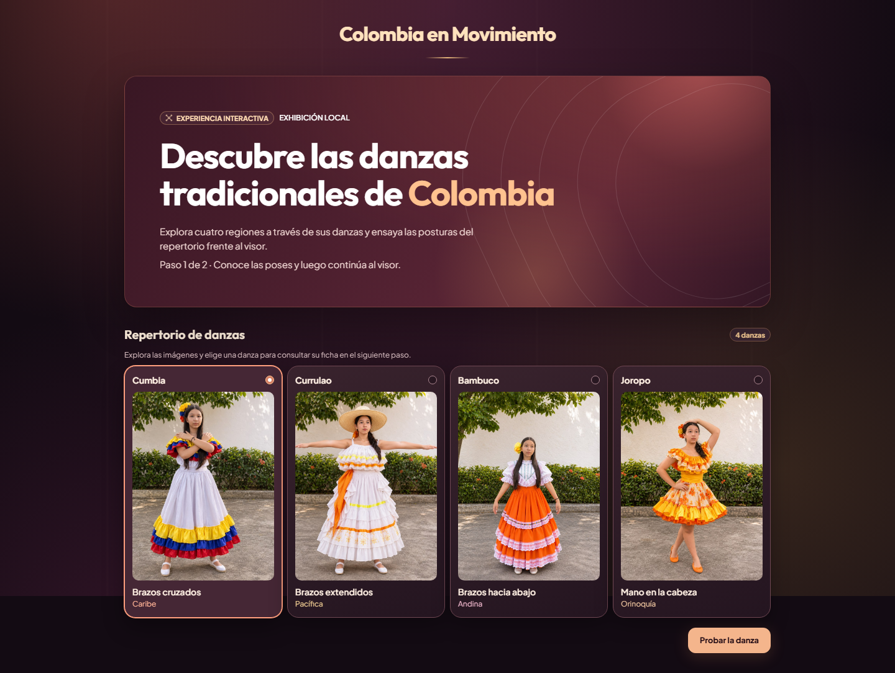
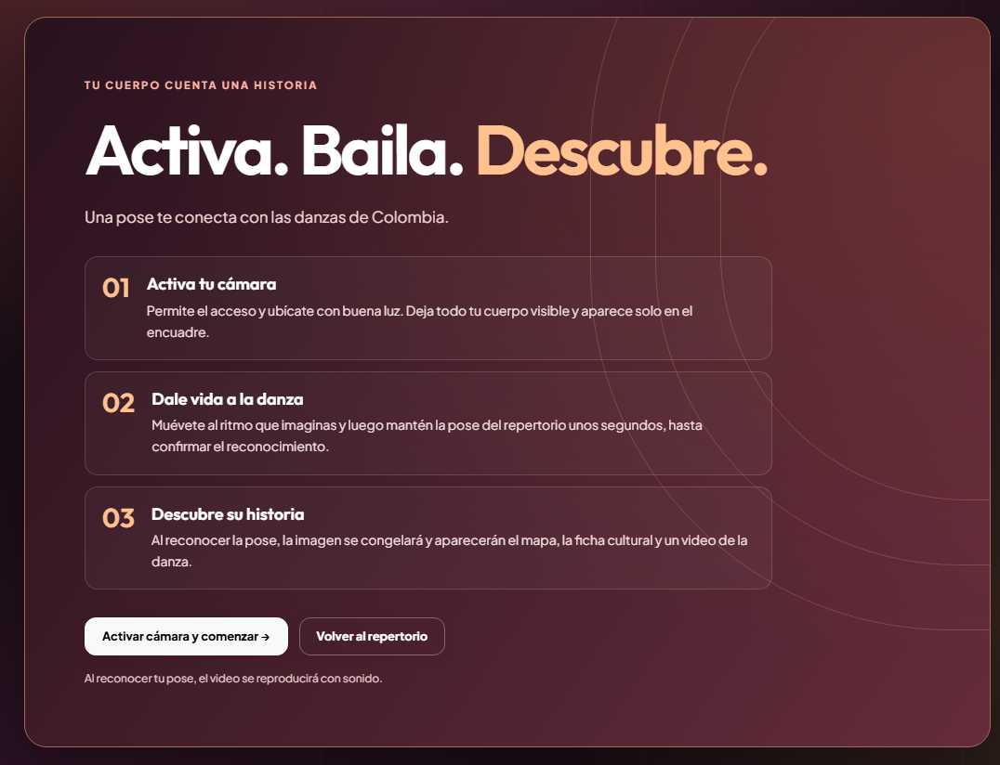
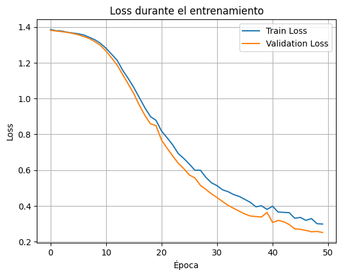
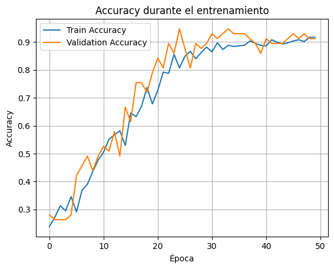
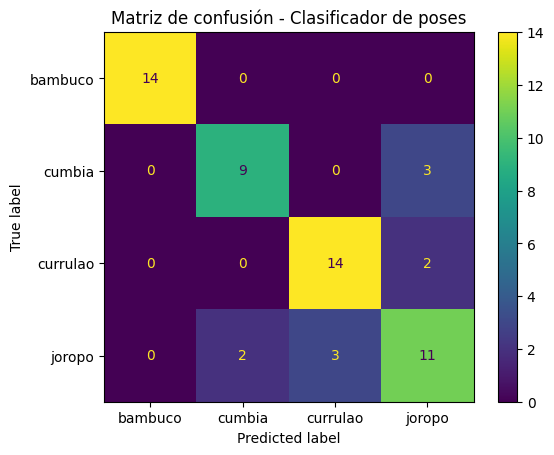
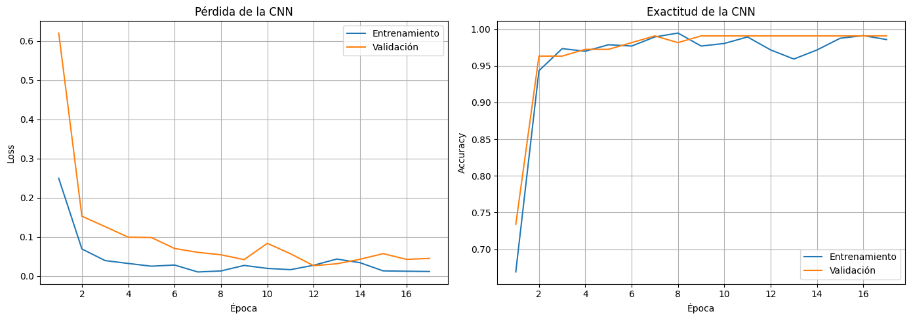
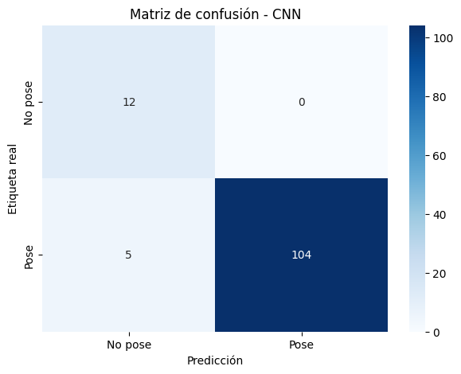

# Colombia en Movimiento

## 1. Introducción y problemática

Colombia en Movimiento es una experiencia cultural interactiva de Procesamiento Digital de Imágenes. La cámara permite explorar cuatro danzas colombianas mediante posturas asociadas a bambuco, cumbia, currulao y joropo. El reto técnico consiste en obtener una señal útil de un fotograma aunque cambien el encuadre, la iluminación o el fondo.

## 2. Justificación y objetivos

El objetivo es conectar el reconocimiento de posturas con fichas sobre las danzas y sus regiones. El sistema busca detectar a una sola persona, filtrar poses dudosas, clasificar la postura y confirmar el resultado antes de abrir el contenido cultural. Cada etapa deja una salida observable para explicar de dónde proviene un rechazo.

## 3. Solución tecnológica

El navegador captura la cámara y envía JPEG a Flask. OpenCV decodifica la imagen, YOLO11 Pose estima la caja y los puntos corporales, MobileNetV2 evalúa el recorte y un perceptrón multicapa (MLP) asigna la danza a partir de las coordenadas. JavaScript presenta el estado, el esqueleto y la ficha cultural. PyTorch y Torchvision cargan los pesos y ejecutan la inferencia en CUDA si está disponible o en CPU.

## 4. Arquitectura del sistema

~~~mermaid
flowchart TD
    subgraph T["Preparación y entrenamiento en notebooks"]
        A["Imágenes etiquetadas por danza"] --> B["Colab YOLO Pose · 17 pares X/Y"]
        B --> C["Dataset de 34 características"]
        C --> D["Entrenamiento y evaluación del MLP"]
        E["Imágenes pose y no_pose"] --> F["Notebook CNN · recortes con YOLO11n"]
        F --> G["Entrenamiento y evaluación MobileNetV2"]
        D --> WM["pose_classifier.pth"]
        G --> WC["cnn_filtro_pose.pth"]
    end
    WY["yolo11n-pose.pt · pesos preentrenados"] -.-> B
    subgraph I["Uso local e inferencia"]
        H["Interfaz y cámara del navegador"] -->|HTTP POST /api/reset| S["Flask · sesión y racha por UUID"]
        S -->|UUID| J["Captura JPEG"]
        J -->|HTTP POST /api/predict| K["Flask · validar sesión y decodificar"]
        K --> Y["YOLO11 Pose · caja y 17 puntos"]
        Y --> P{"¿Exactamente una persona?"}
        P -->|Sí| R["Extraer puntos normalizados y recorte RGB con margen"]
        R --> N{"¿CNN MobileNetV2 acepta la pose?"}
        N -->|Sí| V{"¿Son fiables los 12 puntos requeridos?"}
        V -->|Sí| M{"¿MLP de cuatro clases supera el umbral?"}
        P -->|No| X["Rechazo · reiniciar racha"]
        R -->|Puntos ausentes o recorte inválido| X
        N -->|No| X
        V -->|No| X
        M -->|No| X
        M -->|Sí| Q{"¿Tres predicciones consecutivas de la misma clase?"}
        S -.-> Q
        X --> O["JSON · estado y diagnóstico"]
        Q -->|Todavía no| O
        Q -->|Sí| L["JSON · danza confirmada"]
        O --> U["GUI · estado, esqueleto y racha"]
        U -->|Siguiente fotograma| J
        L --> Z["GUI · danza, confianza, región y ficha cultural"]
    end
    WY -.-> Y
    WC -.-> N
    WM -.-> M
~~~

Los notebooks generan los checkpoints fuera de la aplicación. Flask carga los pesos disponibles al iniciar y emplea los modelos en modo de evaluación.

## 5. Modelos y técnicas de procesamiento digital de imágenes

- **YOLO11n Pose** estima una caja y 17 puntos en cada persona. Las coordenadas se normalizan por el ancho y el alto del fotograma enviado al servidor.
- **Recorte de la persona** amplía la caja un 10 % por lado en cada eje, la limita a los bordes y convierte de BGR a RGB. El recorte reduce el fondo que examina la CNN.
- **MobileNetV2** tiene una cabeza de clasificación 1280 → 128 → 2. La entrada es un recorte RGB redimensionado a 224 × 224 según el checkpoint, convertido a tensor y normalizado con media y desviación estándar de ImageNet guardadas en el archivo. Se usa el softmax de la etiqueta pose.
- **MLP** tiene capas 34 → 64 → 32 → 4, activaciones ReLU y dropout de 0,20 desactivado durante inferencia. Recibe los 17 pares X/Y intercalados del fotograma y devuelve cuatro logits. El orden de salida se lee del checkpoint.

## 6. Metodología y entrenamiento

- **MLP.** El Colab aplica YOLO11n Pose a imágenes etiquetadas, extrae el primer conjunto de puntos disponible por imagen y aplana sus coordenadas normalizadas. Divide los registros de forma estratificada, optimiza con Adam y entropía cruzada y restaura el estado seleccionado en validación. La prueba aislada de imágenes usa un umbral de 0,80. En el predictor integrado, Flask añade sesiones, la restricción de una sola persona y confirmación temporal, y el backend incorpora el filtro CNN y verifica la confianza de las articulaciones. [Notebook YOLO Pose y MLP](https://colab.research.google.com/drive/1P_QJtFgQqiqn2QOLj4hxn5HQ_7Ia2ry1)
- **CNN.** El notebook divide las imágenes originales por clase y usa YOLO11n de detección (yolo11n.pt) para generar recortes de las cajas de personas. El backend obtiene la caja de YOLO11n Pose y exige una sola persona. El entrenamiento parte de MobileNetV2 preentrenada, congela sus características y entrena la cabeza con augmentación, muestreo ponderado y entropía cruzada ponderada. En ejecución se carga el estado completo, con las transformaciones de evaluación. [Notebook local](backend/cnn/CNN.PERSONA.ipynb) · [Versión de Drive](https://colab.research.google.com/drive/1C1Dw6g6KOW2xAwasHEjo24G8yNjjccAT)

## 7. Datasets y distribución

El MLP parte de **572 registros de 34 características**. La división estratificada usa semilla 42.

| Conjunto | Bambuco | Cumbia | Currulao | Joropo | Total |
| --- | ---: | ---: | ---: | ---: | ---: |
| Entrenamiento | 108 | 97 | 125 | 127 | 457 |
| Validación | 13 | 13 | 15 | 16 | 57 |
| Prueba | 14 | 12 | 16 | 16 | 58 |

El dataset original de la CNN contiene **572 imágenes pose y 101 no_pose**. El notebook divide las imágenes originales aproximadamente en 70/15/15. Los recortes son otra unidad de conteo porque una imagen puede generar varios o ninguno.

| Conjunto | Imágenes originales pose / no_pose | Recortes pose / no_pose | Total de recortes |
| --- | ---: | ---: | ---: |
| Entrenamiento | 400 / 70 | 501 / 64 | 565 |
| Validación | 86 / 15 | 108 / 1 | 109 |
| Prueba | 86 / 16 | 109 / 12 | 121 |

El desbalance se mantiene en los conjuntos de evaluación. La validación de recortes contiene **un solo negativo**. [Datos y modelos del equipo](https://drive.google.com/drive/folders/1OiU35X_bGq5RkKuuXAHBH0aeCmfa8w46)

## 8. Parámetros e hiperparámetros

| Parámetro de inferencia | Valor |
| --- | --- |
| Umbral de detección YOLO | 0,25 |
| Margen de recorte | 10 % por lado en cada eje |
| P(pose) mínima de CNN | 0,70 |
| Confianza mínima por punto requerido | 0,50 en cada hombro, codo, muñeca, cadera, rodilla y tobillo |
| Confianza mínima de la clase MLP | 0,70 |
| Confirmación | 3 predicciones consecutivas de la misma clase |
| Intervalo de captura | 400 ms después de procesar la respuesta anterior |
| Reinicio de racha por pausa y caducidad de sesión | Más de 10 s y más de 120 s, respectivamente |

El 0,85 del README anterior era una discrepancia documental. El 0,80 del Colab corresponde a la demo de clasificación aislada. El valor integrado de 0,70 se mantiene.

En entrenamiento, el MLP usa lotes de 32, una tasa de aprendizaje de 0,001 y 50 épocas. Ambos notebooks seleccionan los pesos de menor pérdida de validación. La CNN usa lotes de 16, AdamW con tasa inicial 0,001 y weight decay 0,0001, ReduceLROnPlateau sobre pérdida de validación y hasta 25 épocas con parada tras cinco épocas sin mejora.

## 9. Implementación y organización de archivos

| Ruta | Responsabilidad |
| --- | --- |
| frontend/index.html | Estructura de la interfaz, resultados y fichas culturales |
| frontend/js/main.js | Permisos y ciclo de vida de la cámara, navegación, mapa y medios culturales |
| frontend/js/deteccion.js | Captura JPEG, solicitudes HTTP, descarte de respuestas antiguas y presentación del resultado |
| backend/yolo/api.py | Servicio HTTP y archivos estáticos, validación de sesiones y confirmación temporal |
| backend/yolo/clasificador.py | Pipeline reutilizable de YOLO, recorte, CNN, puntos y MLP |
| backend/yolo/filtro_pose.py | Arquitectura, carga, preprocesamiento e inferencia de la CNN |
| backend/yolo/test_camara.py | Prueba manual con OpenCV sobre el predictor compartido y racha local |
| backend/tests/test_integracion.py | Contrato Flask, pruebas de modelos y casos simulados |
| frontend/js/deteccion.test.cjs | Pruebas de inicio, cancelación y aislamiento de ejecuciones |
| backend/cnn/CNN.PERSONA.ipynb | Preparación, entrenamiento y evaluación de la CNN |
| requirements.txt | Versiones de las dependencias de ejecución local |
| models/, data/, notebooks/ | Pesos locales, datos y espacio reservado para notebooks |
| docs/images/ | Capturas de la GUI y gráficas originales |

La separación permite reutilizar el predictor en Flask y en la prueba de cámara. Flask gestiona la racha de cada sesión y el clasificador trabaja por fotograma. El preprocesamiento de la CNN vive junto a su checkpoint y la interfaz puede actualizar la ficha cultural sin modificar el predictor.

## 10. Funcionamiento del predictor completo

1. La GUI abre la cámara sin audio y obtiene un UUID mediante POST /api/reset.
2. Captura un JPEG, conserva la relación de aspecto y limita el ancho a 1280 píxeles. Envía frame y sesion como multipart a POST /api/predict, con una petición de captura a la vez.
3. Flask valida la sesión y decodifica el JPEG. YOLO11 Pose procesa el fotograma una vez. Se rechazan cero personas o múltiples detecciones.
4. El backend obtiene los puntos y construye el recorte RGB con margen. Una geometría inválida o puntos ausentes detienen el análisis.
5. MobileNetV2 filtra el recorte con P(pose) ≥ 0,70.
6. Se exige confianza ≥ 0,50 en los 12 puntos de brazos, caderas y piernas. La GUI también recibe el recuento de puntos visibles sobre los 17.
7. El MLP recibe un tensor float32 de forma 1 × 34. Si el máximo softmax alcanza 0,70, devuelve la clase candidata.
8. Una clase igual incrementa la racha de la sesión. Una clase distinta inicia otra racha en uno. El rechazo o la pausa larga la reinicia. Un bloqueo protege la inferencia compartida.
9. Con tres coincidencias, la GUI detiene la captura y muestra la danza, la región, la confianza MLP y la ficha cultural con mapa, fotografía y video.

GET / sirve la GUI y GET /api/health responde con la disponibilidad del servicio y las confirmaciones requeridas. La predicción devuelve estado, clase, confianza, confianza_pose, personas, puntos_visibles, keypoints (triples X/Y/confianza), consecutivas, requeridas, confirmada y danza. La confianza CNN es null si no se evaluó y danza es null hasta confirmar.

Los estados posibles son sin_persona, multiples_personas, no_pose, puntos_insuficientes, sin_clasificacion, analizando y confirmada. La API responde con errores JSON para entradas inválidas (400), sesión vencida (409), solicitud superior a 8 MiB (413), fallo interno (500) y cupo de sesiones agotado (503). Una imagen decodificada de más de 16 megapíxeles devuelve 400. Las imágenes se procesan en memoria.

## 11. Interfaz gráfica y capturas

| Figura 1. Repertorio | Figura 2. Instrucciones | Figura 3. Visor de cámara |
| :---: | :---: | :---: |
|  |  |  |
| Selección de danza, postura y región. | Guía para activar la cámara y mantener la pose. | Encuadre y selección de cámara. |

## 12. Métricas, gráficas y resultados

La **accuracy** mide la proporción total de aciertos. La **precision** mide qué fracción de las predicciones de una clase corresponde realmente a ella. El **recall** mide qué fracción de los casos reales de una clase se recuperó. El **F1-score** es la media armónica de precision y recall. La **pérdida** mide cuánto penaliza la función objetivo las probabilidades asignadas. La **matriz de confusión** cruza clases reales y predichas, con los aciertos en la diagonal.

### MLP de cuatro danzas

El Colab registra **48/58 aciertos (82,76 %)** y una pérdida de prueba de **0,3696**.

Las cinco gráficas de esta sección son salidas PNG extraídas de los dos notebooks de Drive enlazados en la metodología.

| Danza | Precision | Recall | F1-score | Muestras |
| --- | ---: | ---: | ---: | ---: |
| Bambuco | 1,0000 | 1,0000 | 1,0000 | 14 |
| Cumbia | 0,8182 | 0,7500 | 0,7826 | 12 |
| Currulao | 0,8235 | 0,8750 | 0,8485 | 16 |
| Joropo | 0,6875 | 0,6875 | 0,6875 | 16 |

*Figura 4. Pérdida de entrenamiento y validación del MLP por época.*

*Figura 5. Fracción de aciertos del MLP en entrenamiento y validación por época.*

*Figura 6. Errores entre las cuatro danzas en los 58 registros de prueba. Joropo tiene el menor recall, con 11 aciertos de 16 casos.*

### CNN binaria

La versión de Drive registra **116/121 aciertos (95,87 %)**, con 104/109 poses y 12/12 negativos clasificados correctamente por argmax. Cinco poses se clasificaron como no_pose. La copia del repositorio conserva una salida diferente sobre 121 recortes, con accuracy redondeada de 0,88 y recall de 0,00 para no_pose.

*Figura 7. Curvas de entrenamiento y validación de la versión de Drive. La validación contiene un negativo.*

*Figura 8. Matriz de prueba de la versión de Drive. Las filas son etiquetas reales y las columnas son predicciones.*

## 13. Análisis de errores y limitaciones

Las métricas de los notebooks describen el desempeño de cada modelo sobre su propio conjunto de prueba. Los 12 negativos de prueba y el único negativo de validación limitan la evidencia sobre falsos positivos de la CNN.

Una caja incorrecta, oclusiones, luz insuficiente o un encuadre diferente pueden interrumpir la racha. La regla temporal exige consistencia de clase y puede repetir un error estable. La aplicación reconoce posturas de interacción a partir de fotogramas.

## 14. Instalación y ejecución local

Desde la raíz del proyecto, usar Python 3.13, versión del entorno original, o Python 3.12.14, versión comprobada en esta revisión. Preparar los pesos en estas rutas.

| Archivo | Uso |
| --- | --- |
| yolo11n-pose.pt | YOLO11n Pose, en la raíz |
| models/cnn/cnn_filtro_pose.pth | MobileNetV2 binaria |
| models/yolo/pose_classifier.pth | MLP de cuatro clases |

Los dos .pth pueden obtenerse del Drive del equipo y están ignorados por Git. El servidor indica la ruta si falta un modelo. [Datos y modelos del equipo](https://drive.google.com/drive/folders/1OiU35X_bGq5RkKuuXAHBH0aeCmfa8w46)

~~~powershell
python -m venv .venv
.\.venv\Scripts\python.exe -m pip install -r requirements.txt
.\.venv\Scripts\python.exe -m backend.yolo.api
~~~

Abrir [la interfaz local](http://127.0.0.1:5000) y conceder acceso a la cámara. También se admite Live Server desde localhost con la API de Flask en el puerto 5000. Si Python no está en PATH, usar su ruta completa. CUDA depende de la instalación de PyTorch.

## 15. Pruebas y validación

~~~powershell
.\.venv\Scripts\python.exe -m unittest discover -s backend/tests -v
node --test frontend/js/deteccion.test.cjs
.\.venv\Scripts\python.exe -m backend.yolo.test_camara
~~~

La suite Flask comprueba archivos estáticos, salud de la API, entrada inválida, recorte y tensor del MLP, confirmación, cambio de clase, reinicio, aislamiento y caducidad. Incluye una prueba de humo con un fotograma vacío y una llamada independiente a la CNN real. Los positivos de las pruebas de contrato son simulados. La prueba manual de OpenCV requiere cámara y se cierra con Q.

En esta revisión pasaron las seis pruebas de Python 3.12.14 con las dependencias fijadas y las tres pruebas de JavaScript. Los tres pesos locales cargaron en CPU, la CNN aplicó la transformación de 224 × 224 y una pasada real del MLP produjo cuatro logits a partir de 34 valores. Los dos archivos .pth coincidieron por SHA-256 con los de Drive.

Por HTTP en localhost se verificó la entrega de la página y de sus scripts, el estado de salud, la creación de sesión y una predicción multipart con un fotograma vacío, que devolvió sin_persona.

Una comprobación adicional con el cliente de Flask confirmó currulao al enviar tres veces la misma imagen local. La secuencia verificó la integración y los estados de racha con pesos reales.

## 16. Conclusiones

El flujo implementado combina cajas y puntos corporales, clasificación binaria de recortes, clasificación de cuatro posturas y confirmación por sesión para activar el contenido cultural. Los notebooks documentan el entrenamiento y la evaluación de cada modelo. Las pruebas de integración comprueban cómo se conectan los modelos, la API y la interfaz.

## 17. Equipo y referencias

**Universidad Autónoma de Occidente**

**Asignatura** Procesamiento Digital de Imágenes

**Docente** Nicolás Llanos Neuta

| Integrante | Rol principal | Responsabilidades |
| --- | --- | --- |
| Santiago Mejía Suárez | Responsable técnico | Arquitectura, integración frontend y backend, coordinación técnica y seguimiento de visión computacional |
| Jean Carlo Caicedo Chantre | Responsable funcional | Requisitos, alcance, escenarios de uso y correspondencia con necesidades |
| Jhoan Esteban Burgos | Responsable de interacción | Experiencia de usuario, navegación, prototipado, retroalimentación y coherencia visual |
| Karol Lizeth Grain Mosquera | Validadora | Planificación y ejecución de pruebas, revisión de criterios de aceptación y oportunidades de mejora |

Los roles describen responsabilidades organizativas del equipo. No asignan autoría exclusiva de archivos ni certifican tareas individuales realizadas.

### Referencias y atribuciones

#### Ingeniería, modelos y herramientas

- [Repositorio del proyecto](https://github.com/SantiagoMejia064/SistemaVisionComputacional) y [prototipo en Figma](https://www.figma.com/design/E15852kz3GEqF0mtmDZLiC/Untitled?node-id=0-1).
- [Flask](https://flask.palletsprojects.com/en/stable/), [Flask-CORS](https://flask-cors.readthedocs.io/en/latest/) y [Python](https://docs.python.org/3/).
- [PyTorch](https://pytorch.org/get-started/locally/), [OpenCV](https://docs.opencv.org/4.x/) y [NumPy](https://numpy.org/doc/stable/).
- [Ultralytics en GitHub](https://github.com/ultralytics/ultralytics), [YOLO11](https://docs.ultralytics.com/models/yolo11/) y [estimación de poses](https://docs.ultralytics.com/tasks/pose/).
- [Media Capture and Streams](https://www.w3.org/TR/mediacapture-streams/) para acceso a dispositivos de cámara.
- [Bootstrap](https://getbootstrap.com/docs/5.3/) y [Live Server](https://github.com/ritwickdey/vscode-live-server).

#### Fuentes culturales y cartografía

- [Cumbia tradicional del Caribe colombiano](https://patrimonio.mincultura.gov.co/salvaguardiapci/Lista-Representativa/Paginas/Cumbia-tradicional-del-Caribe-Colombiano.aspx).
- [Músicas de marimba y cantos tradicionales](https://mng.mincultura.gov.co/areas/patrimonio/patrimonio-cultural-en-Colombia/Paginas/Lista-Representativa-del-Patrimonio-Cultural-Inmaterial.aspx) y [Danzas guapireñas](https://colombiaaprende.edu.co/sites/default/files/files_public/plan-lectura-2021/territorios-narrados-parte-1/Danzas_guapirenas.pdf).
- [Danzas de la región Andina](https://contenidos.mineducacion.gov.co/ntg/men/archivos/Referentes_Calidad/Modelos_Flexibles/Secundaria_Activa/Guias_del_estudiante/Educacion_Artistica/ART__Danza.pdf) y [traje típico del sanjuanero huilense](https://www.huila.gov.co/publicaciones/719/traje-tispico-69064/).
- [Pobladores del Orinoco](https://enciclopedia.banrepcultural.org/Pobladores_del_Orinoco) y [vestuario del joropo en Casanare](https://feriasdellibro.mincultura.gov.co/contenidos_digitales/tradiciones-del-vestuario-asociadas-al-baile-del-joropo-en-casanare-siglos-xix-y-xx/).
- [GeoJSON de Colombia](https://github.com/johan/world.geo.json/blob/master/countries/COL.geo.json), base geográfica del mapa. Las cuatro zonas culturales internas son esquemáticas.

#### Licencias de recursos y dependencias

| Recurso | Licencia o condición de consulta |
| --- | --- |
| Bootstrap | MIT. Se conserva [su licencia local](frontend/css/bootstrap-LICENSE.txt). |
| Outfit | SIL Open Font License 1.1. [Licencia local](frontend/assets/fonts/OFL-Outfit.txt). |
| Plus Jakarta Sans | SIL Open Font License 1.1. [Licencia local](frontend/assets/fonts/OFL-Jakarta.txt). |
| Ultralytics | El repositorio publica AGPL-3.0 y ofrece licencia Enterprise. Revisar las condiciones aplicables al código y los pesos utilizados. [Licencia](https://github.com/ultralytics/ultralytics/blob/main/LICENSE), [opciones de licencia](https://www.ultralytics.com/license). |
| Flask y Flask-CORS | Consultar licencias de las versiones instaladas. [Flask](https://github.com/pallets/flask/blob/main/LICENSE.txt), [Flask-CORS](https://github.com/corydolphin/flask-cors/blob/main/LICENSE). |
| PyTorch, NumPy y OpenCV | Consultar atribuciones y licencias en las distribuciones instaladas. [PyTorch](https://github.com/pytorch/pytorch/blob/main/LICENSE), [NumPy](https://github.com/numpy/numpy/blob/main/LICENSE.txt), [OpenCV](https://github.com/opencv/opencv/blob/4.x/LICENSE). |
| Datos y checkpoint del equipo | Disponibles en Drive. No se identificó una licencia de redistribución dentro de los archivos del repositorio inspeccionado. |
| Cartografía y fuentes culturales | Se conservan enlaces de atribución. Comprobar las condiciones de reutilización al publicar recursos derivados. |

Las capturas de `docs/images/` muestran la interfaz del proyecto y no incluyen fotografías de visitantes. No existe un archivo de licencia global del proyecto en esta revisión, por lo que este README no declara una.
